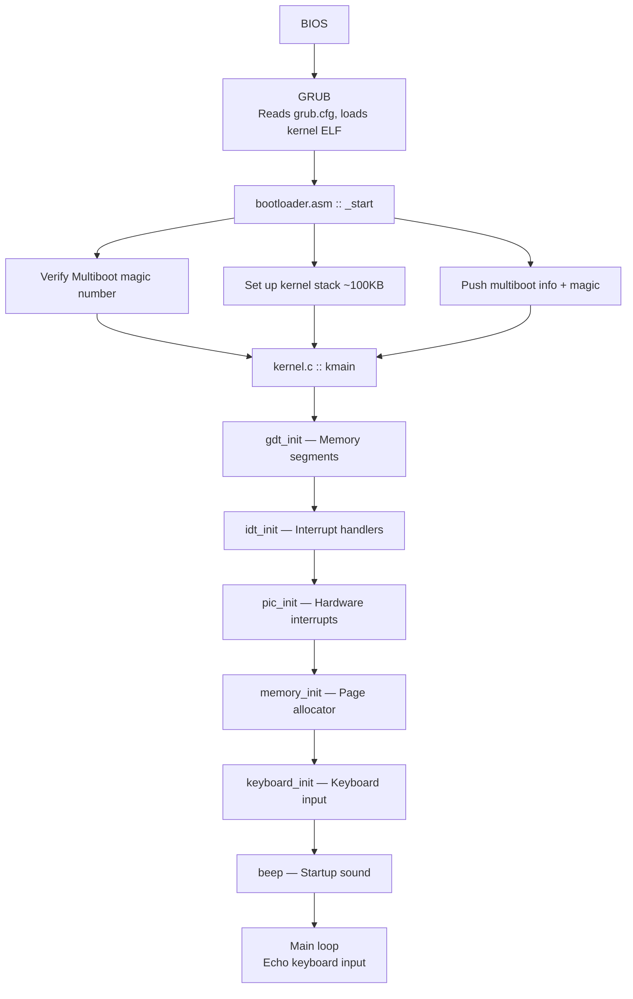
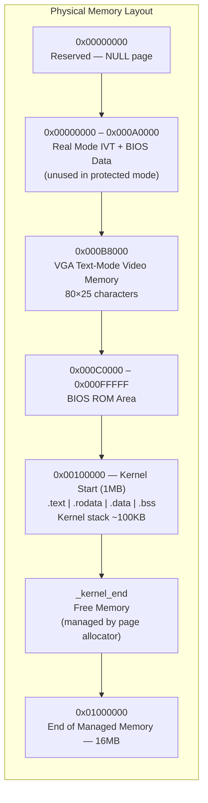
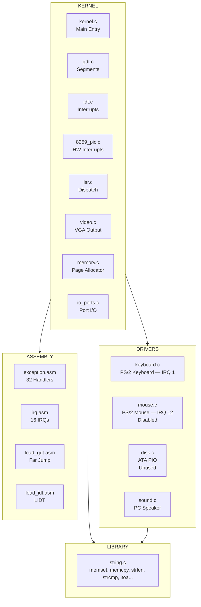

# AutismOS — System Architecture

## Overview

AutismOS is a 32-bit x86 operating system that runs in Protected Mode. It uses GRUB as its bootloader and operates directly on hardware (bare-metal, freestanding environment — no standard C library).

## Boot Flow

## Memory Layout

## Component Map

## Interrupt Map

| IRQ | Vector | Source | Handler |
|-----|--------|--------|---------|
| — | 0–31 | CPU Exceptions | `exception.asm` → `isr_exception_handler()` |
| 0 | 32 | PIT Timer | (not yet implemented) |
| 1 | 33 | Keyboard | `keyboard_handler()` |
| 12 | 44 | Mouse | `mouse_handler()` (disabled) |
| — | 128 | Syscall | `exception.asm` (not yet implemented) |

## Privilege Levels

| Ring | Purpose | Status |
|------|---------|--------|
| Ring 0 | Kernel code & data | ✅ Active (GDT entries 1–2) |
| Ring 3 | User code & data | ⚠️ GDT entries defined (3–4) but not used yet |

## Key Design Decisions

1. **Flat memory model** — All segments span the full 4GB address space. No segmentation tricks.
2. **Physical memory only** — No paging enabled yet. All addresses are physical.
3. **Monolithic kernel** — Everything runs in kernel space (Ring 0).
4. **VGA text mode** — 80×25 character display. No graphics mode.
5. **Polling I/O** — Keyboard uses interrupt-driven input, but disk uses polling (PIO mode).
